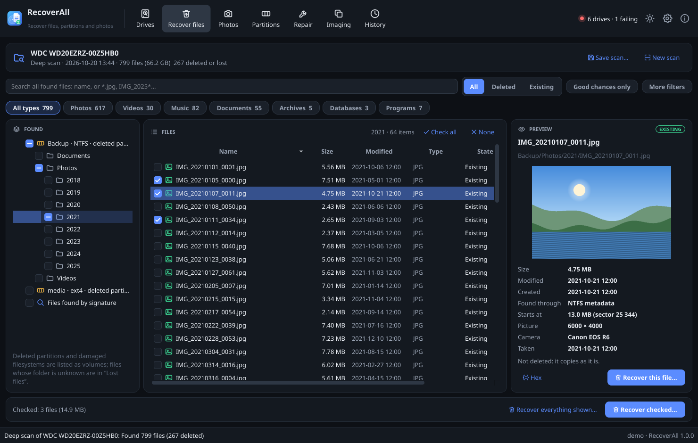
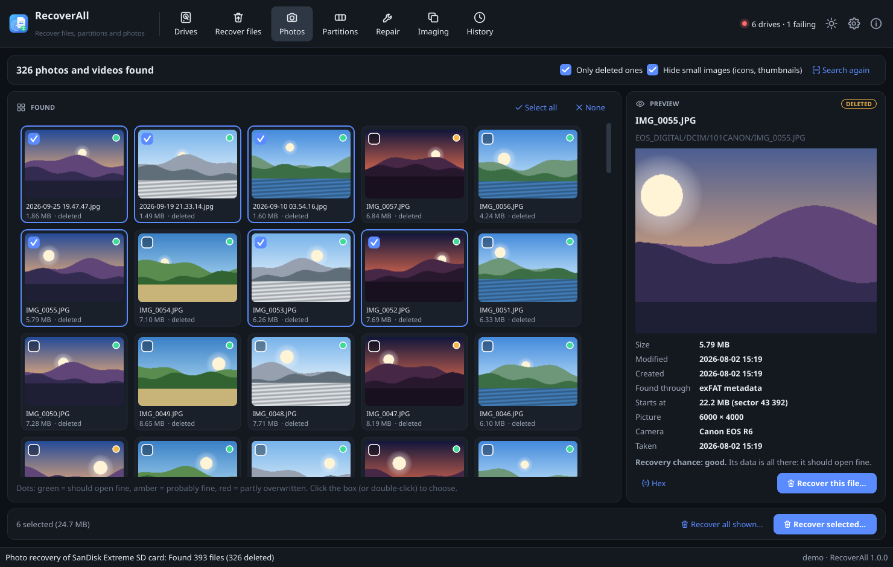
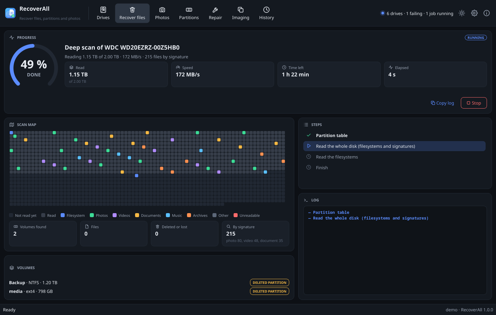
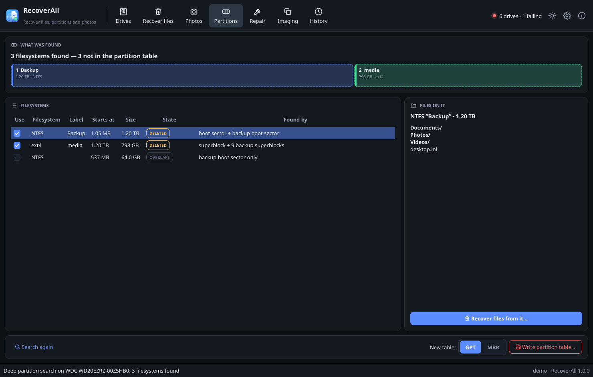
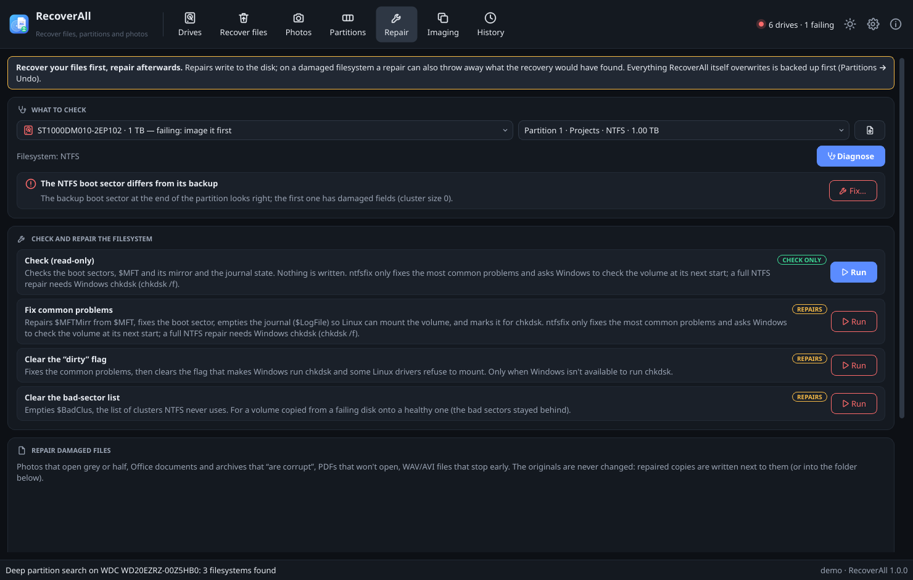
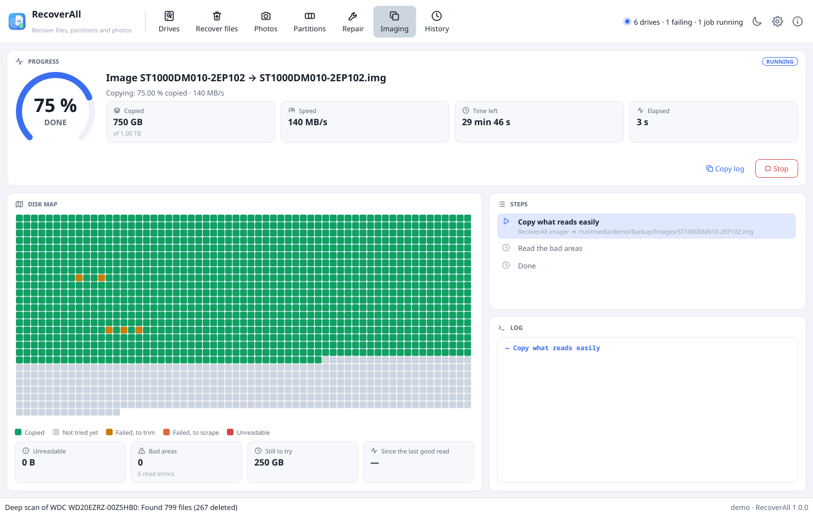
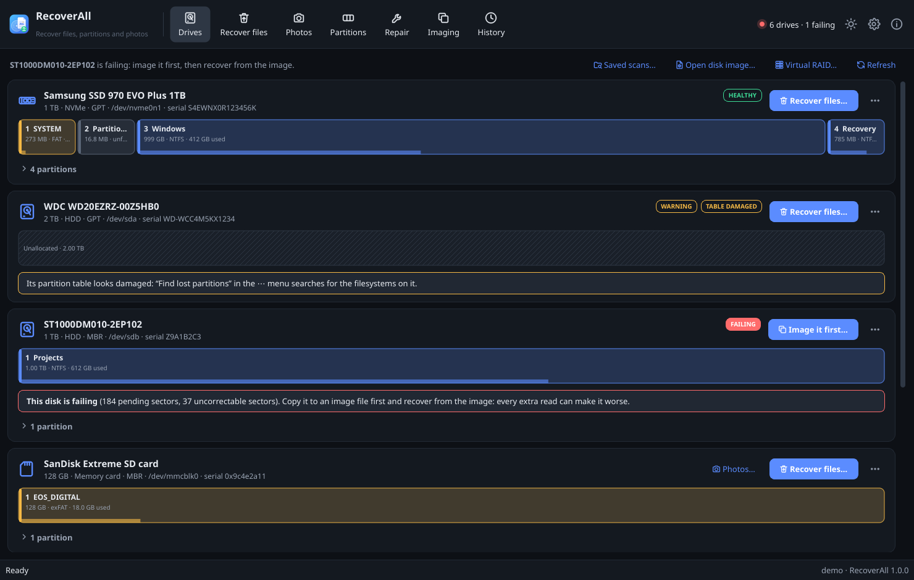

# RecoverAll: get back deleted files, photos and lost partitions on Linux

RecoverAll recovers data the way **R-Studio** and **GetDataBack** do on Windows, and the way **TestDisk**
and **PhotoRec** do everywhere. It handles simple jobs, like getting back the photos you just deleted from
a camera card or restoring a partition table that got wiped. It also handles hard ones: a formatted or
corrupted drive, a disk whose boot sectors are gone, a failing disk that has to be imaged first, or a RAID
whose controller died. It's built for Arch Linux, runs on every popular distribution, and works on X11
and Wayland.



> RecoverAll is an independent project. It is not affiliated with R-Studio, GetDataBack, TestDisk,
> PhotoRec or untrunc; those names only describe what RecoverAll does.

## Features

**Recover files, like R-Studio and GetDataBack**
- **Quick scan** reads the partition table and the filesystems, and lists every file with the deleted
  ones marked: names, folders, sizes and dates, in the folder tree they came from.
- **Deep scan** reads the whole disk. It finds filesystems that are **damaged, formatted, or no longer
  in any partition**. NTFS volumes are rebuilt from their MFT records even when both boot sectors are
  gone, and FAT folders are found again after a quick format. A signature search also runs over the free
  space.
- Every file gets a **recovery chance** (*good*, *fair*, *poor*). It is based on whether its clusters are
  still free or were given to another file since.
- **Browse, filter and preview before recovering.** Search by name or wildcard. Filter by type, size,
  date, deleted or existing, and chance. Preview pictures (with RAW camera thumbnails and EXIF), videos
  (length, picture size, codecs and a frame), text, Office documents, PDFs and the raw bytes in a hex viewer.
- Recovered files keep their **names, folders and dates**. Nothing is ever overwritten: name collisions get
  " (2)". Names Windows can't take are made safe when recovering to FAT or NTFS. A report lists what came
  back and what didn't.
- **Scans are saved** (`.rascan` files), so you can open them again later and recover more without
  scanning again.

**Photos and the signature search, like PhotoRec**
- **119 file types** (276 extensions) are found by their content alone. This works when the filesystem is
  gone or was overwritten: JPEG, the RAW formats of Canon, Nikon, Sony, Fuji, Olympus, Panasonic, Pentax,
  Samsung and Adobe (CR2, CR3, NEF, ARW, RAF, ORF, RW2, PEF, SRW, DNG), HEIC, PNG and more. Videos (MP4/MOV,
  MKV, AVI, MTS…), audio, Office and OpenDocument files, PDFs, archives, mailboxes (PST, mbox), databases
  (SQLite, Access, KeePass) and more are covered too.
- Files are cut at their **real end**, read from the format's own structure (box sizes, markers, chunk
  tables), not at a guessed maximum size. A file that's damaged in the middle is reported as such.
- The **Photos** page is one step: pick the card or disk, and get a gallery of the deleted photos and
  videos to tick and save.
- Search only the **free space** (fast, finds only deleted files) or the **whole disk**. Files found both
  ways are listed once.

**Videos: found, previewed and repaired**
- **Recordings that were never finished** (the battery died, the app crashed, the card was pulled out while
  recording) have every frame but no index, so no player opens them. RecoverAll rebuilds the index of MP4,
  MOV and 3GP files from the frames themselves, like untrunc. Give it a good recording from the same camera
  with the same settings, and it learns the tracks, the codecs, the timing and the way the camera
  interleaves picture and sound. It handles H.264, H.265, ProRes, Motion JPEG, MPEG-4 and H.263 video, AAC,
  AMR, AC-3, MP3 and PCM sound, and timecode and GoPro metadata tracks. B-frames get their display order
  back. Without a reference, a camera that repeats its stream settings in the video still gets its picture
  back.
- **The signature search recognizes them**: media data without an index whose content is valid video is
  listed under *Unfinished recordings*, cut where the recording stopped.
- **Fragmented videos are put back together.** Big recordings on FAT32, exFAT and NTFS are often stored in
  several pieces. Every frame is checked where the video's index puts it; where they stop fitting, the next
  frames are searched for further on the disk, and the cut between two pieces is placed on the block
  boundary that fits best. Up to 64 pieces per video.
- **Every common container is repaired**: MKV and WebM (cut short, damaged in the middle, a lost seeking
  index or duration, a lost start), MPEG-TS, MTS and M2TS from AVCHD camcorders, MPG, VOB and MOD, WMV and
  ASF, FLV and AVI. Damaged stretches are dropped, the picture resumes at the next key frame, and sizes,
  durations and indexes are set to what is really there. A lost header is taken from a reference file.
- **Previews before recovering**: length, picture size, frame rate, codecs and a picture of the first key
  frame, read from the file's own structure wherever its index lies. Pictures are decoded by ffmpeg, which
  runs as your user (never as root), with memory and time limits, because the data comes from a damaged
  disk.

**Photos: repaired exactly, put back together, and found in thumbnail caches**
- **JPEG damage is found exactly** by decoding the picture data, not guessed from the bytes. A photo that
  is cut short or overwritten keeps every block up to the damage, and the rest is filled with grey coded
  with the photo's own tables: it keeps its size and opens in every program. With restart markers, only the
  damaged stretches turn grey and the rest of the photo shows in its place. A progressive photo keeps its
  last complete pass. A damaged header or damaged tables are rebuilt, from a reference photo of the same
  camera if needed.
- **Fragmented photos are put back together.** Where a photo's data breaks off, the search looks further on
  the disk for the cluster where it goes on: one whose data decodes validly from exactly the state where
  the photo stopped. Of those, the one that best continues the picture above the break is taken.
- **RAW photos that can't be developed** (CR2, CR3, NEF, ARW, RAF, ORF, RW2, PEF, DNG, SRW and more) still
  have the full-size JPEG the camera stored with them. It is found, checked and saved as *name (preview).jpg*.
- **Thumbnails of deleted photos**: when a photo is gone for good, the thumbnail Windows, Android, macOS or
  your Linux desktop made of it often isn't. Scans read `thumbcache_*.db`, `Thumbs.db`, Android
  `.thumbdata`, freedesktop and QuickLook caches, and list what they hold under *Thumbnails of deleted
  photos*, with the original's name, folder and date where the cache kept them.
- **Repair after recovery**: recovered photos and videos that may be damaged (found by signature, deleted
  with less than a good chance, or with unreadable parts) are checked, and each damaged one gets a repaired
  copy, *name (repaired).ext*, next to it. The file as it came back stays. The report says what was
  repaired and what needs a reference file.

**Lost partitions and boot sectors, like TestDisk**
- **Quick Search** probes the usual partition starts. **Deep Search** reads every sector. Both find NTFS,
  FAT, exFAT, ext2/3/4, XFS, Btrfs, HFS+, APFS, swap, LUKS, LVM and RAID members, and more, and list the
  first files of each volume so you can tell which one is right.
- Found partitions are checked against each other (overlaps, a volume inside another one). A new **GPT or
  MBR table** is proposed, including logical partitions. You can change it, then write it.
- **Every write can be undone.** The sectors about to change are saved first and checked against their
  hashes. A write is refused when the disk or one of its partitions is mounted or in use.
- **Boot sector repairs**: copy the NTFS, FAT32 or exFAT backup boot sector over a damaged one (or the
  other way round). Rebuild the main GPT from its backup (or the reverse). Write a protective MBR or the
  55 AA signature. Copy the intact FAT over a damaged one. Find ext backup superblocks for e2fsck.

**Corrupt and failing disks**
- **Image a failing disk first** with GNU ddrescue (or the built-in imager). The easy areas are read first,
  then the bad ones are retried. It can stop and resume, and keeps a **live map** of what was read. Then
  scan the image instead of the dying disk. Unreadable sectors read as zeros, and files that touch them are
  marked.
- **Virtual RAID**: RAID 0, 1, 5, 6, 10 and JBOD made of disks or images, with **one member missing**
  (RAID 5) or two (RAID 6). The settings are read from Linux md superblocks, or **detected** by trying
  stripe sizes, orders and layouts. Save the setup as a `.rallraid` file and scan it like a disk.
- **Encrypted volumes**: unlock LUKS and BitLocker (cryptsetup) read-only, then scan what's inside.
- **Filesystem repair** with each filesystem's own tool (`e2fsck`, `fsck.fat`, `fsck.exfat`, `ntfsfix`,
  `xfs_repair`, `btrfs`, `fsck.hfsplus`, F2FS, JFS, ReiserFS). A read-only check comes first, then the
  repair, with a plain explanation of what each option does.
- **Repair damaged files**: the photos and videos above, and PNG, GIF, ZIP/DOCX/XLSX/ODT, PDF (a new
  cross-reference table), WAV/AIFF/WebP, MP3 and gzip/bz2/xz. The original file is never changed.
- **Disk images** work everywhere a disk does, without root: raw images (`.img`, `.dd`, `.iso`, split
  `.001`/`.aa`, ddrescue output), **virtual machine disks** (VirtualBox VDI, VMware VMDK, Hyper-V VHD/VHDX,
  QEMU QCOW2) and **EnCase E01** forensic images, read natively, plus `.rallraid` virtual RAIDs.

**Everything else**
- A **command-line tool**, `recoverctl`, for scripts and SSH: everything the app does.
- **History** of every operation with its full log.
- **Dark and light themes** in the same design as [CloneAndRecover](https://github.com/oreo1298/CloneAndRecover),
  [DiskHealth](https://github.com/oreo1298/DiskHealth), [LinBurn](https://github.com/oreo1298/ImgBurnLinux) and
  [VirtConvert](https://github.com/oreo1298/VirtConvert).
- **Demo mode** with six simulated disks (a failing one, a wiped partition table and a formatted card
  included), so you can try everything safely.

| Deleted photos from a camera card | Searching a disk |
|---|---|
|  |  |

| Lost partitions found by the deep search | Repairing a damaged boot sector |
|---|---|
|  |  |

| Imaging a failing disk (light theme) | Drives |
|---|---|
|  |  |

## Which search to use

| You lost… | Use | What it reads |
|---|---|---|
| Files you just deleted (Shift+Delete, emptied Trash) | **Quick scan** | the filesystem's own records: minutes |
| Photos and videos from a camera card or phone | **Photos** | the filesystem, then the free space by signature |
| A video that won't play (the camera stopped while recording) or a photo that is grey or cut off | **Repair** (with a good file from the same camera) | the damaged file; a repaired copy is written |
| A formatted drive, a "RAW" or "needs to be formatted" partition, a disk Linux can't mount | **Deep scan** | every sector: lost filesystems, rebuilt folders, signatures |
| A partition that disappeared (the partition table was wiped or overwritten) | **Partitions** | Quick Search, then Deep Search; write the table back |
| Files on a disk whose filesystem was overwritten (reinstalled OS, new format with a different type) | **Signatures only** | every sector, by file content |
| Anything on a disk that clicks, hangs or shows reallocated sectors | **Imaging** first | the disk once, the easy parts first; then scan the image |

## Filesystems

| Filesystem | Files | Deleted files | Damaged, formatted or lost | Repair tool |
|---|---|---|---|---|
| **NTFS** (Windows) | native: streams, NTFS and Windows 10 (XPRESS/LZX) compression | names, folders and content from MFT records | rebuilt from MFT records when both boot sectors are gone | ntfsfix, boot sector from its backup |
| **FAT12/16/32** (cards, USB sticks, EFI) | native, long names | names, sizes, content (contiguous files) | folders rebuilt after a quick format | fsck.fat, boot sector and FAT copies |
| **exFAT** (SDXC cards, big sticks) | native | names, sizes and content (fragmented too, while the FAT still holds them) | backup boot region | fsck.exfat, boot region from its backup |
| **ext2/3/4** (Linux) | native: extents, inline data, the journal replayed in memory | names and content from the journal's older copies | backup superblocks | e2fsck (also from a backup superblock) |
| **XFS** | native, v4 and v5 | content from the extent records deleted inodes keep, names when a folder still has them | backup superblocks in every allocation group | xfs_repair |
| **HFS+ / HFSX** (macOS before 10.13, Time Machine disks) | native: resource forks, compressed files, hard links | catalog remnants and the journal | the alternate volume header | fsck.hfsplus |
| **Btrfs** | btrfs-progs, compressed files included | files that only older trees still have | backup superblocks | btrfs check, super-recover, zero-log, chunk-recover |
| **APFS**, **UFS1/2** | The Sleuth Kit | what TSK finds | — | — |
| **ISO 9660** (CD/DVD images) | native: Joliet, Rock Ridge, files over 4 GiB | — | — | — |
| **ReFS, F2FS, ZFS, UDF, JFS, ReiserFS, LVM, RAID, LUKS, BitLocker** | detected by partition and deep searches; files found by signature | — | — | F2FS, JFS and ReiserFS fsck |

Everything is read-only. The disk you recover from is opened with `O_RDONLY` and is never mounted.

## Installation

RecoverAll needs **Python 3.10+**, **PySide6** (Qt 6) for the app, **util-linux** and **polkit**. The
recovery engines (filesystems, signature search, partition search) are RecoverAll's own and need nothing
else. Optional tools add more:

| Tool | Package | What it adds |
|---|---|---|
| `ddrescue` | ddrescue (Debian/Ubuntu/openSUSE: gddrescue) | the best imager for failing disks (a built-in one is used otherwise) |
| `smartctl` | smartmontools | disk health warnings |
| `fls`, `icat` | sleuthkit | APFS and UFS, and a second opinion on the other filesystems |
| `btrfs` | btrfs-progs | reading and repairing Btrfs |
| `cryptsetup` | cryptsetup | unlocking LUKS and BitLocker volumes |
| `mdadm` | mdadm | reading Linux software-RAID members |
| `ffmpeg` | ffmpeg (Fedora: ffmpeg-free) | pictures in video previews |
| `e2fsck`, `fsck.fat`, `fsck.exfat`, `ntfsfix`, `xfs_repair`, `fsck.hfsplus` | e2fsprogs, dosfstools, exfatprogs, ntfs-3g, xfsprogs, hfsprogs | filesystem repair |

Reading whole disks needs root. The app runs as you; when it needs a disk it asks for your password once
(polkit) and starts a small helper for the session. Disk image files you own work without a password. The
command-line tool runs with `sudo` for disks.

### Arch Linux, CachyOS, EndeavourOS, Manjaro, Garuda and other Arch-based distributions

The repository includes a PKGBUILD, so RecoverAll installs as a normal pacman package:

```bash
sudo pacman -S --needed git base-devel
git clone https://github.com/oreo1298/RecoverAll.git
cd RecoverAll
makepkg -si
```

For imaging, health warnings, the second engine, encrypted volumes, video previews and repairs, add the
optional dependencies:

```bash
sudo pacman -S --needed ddrescue smartmontools sleuthkit btrfs-progs cryptsetup mdadm ffmpeg \
  e2fsprogs dosfstools exfatprogs ntfs-3g xfsprogs
```

- **Update:** `cd RecoverAll && git pull && makepkg -sif`
- **Uninstall:** `sudo pacman -Rns recoverall`. Saved scans, history and the partition-table backups used for
  Undo stay in `/var/lib/recoverall`; delete that folder if you don't need them. Recovered files are never
  touched.

### Every other distribution: the installer

`packaging/install.sh` recognizes your package manager (**apt, dnf, zypper, xbps, apk, eopkg, emerge**). It
installs the dependencies after asking, installs RecoverAll into `/opt/recoverall`, and adds the menu entry,
the icon and the polkit helper:

```bash
git clone https://github.com/oreo1298/RecoverAll.git
cd RecoverAll
./packaging/install.sh          # asks for your password (sudo)
```

- **Update:** `cd RecoverAll && ./packaging/update.sh`. It pulls the latest version and reinstalls the same
  way. Settings, saved scans and history stay.
- **Uninstall:** `./packaging/uninstall.sh`. Add `--purge` to also delete settings, saved scans, history and
  the backups used for Undo. Recovered files are never touched.
- Options: `--minimal` installs only what the app needs (no optional tools). `--no-deps` installs nothing
  with your package manager. `--yes` doesn't ask.

The first step for your distribution, before cloning:

| Distribution | Install git first |
|---|---|
| **Debian 12/13, Ubuntu 22.04 and newer, Linux Mint, Pop!_OS, Zorin OS, elementary OS, KDE neon** | `sudo apt install git` |
| **Fedora, Nobara, Ultramarine** | `sudo dnf install git` |
| **RHEL, AlmaLinux, Rocky Linux 9+** | `sudo dnf install epel-release git` (ddrescue, sleuthkit and ntfs-3g come from EPEL) |
| **openSUSE Tumbleweed / Leap** | `sudo zypper install git` |
| **Void Linux** | `sudo xbps-install -S git bash` |
| **Alpine Linux** | `sudo apk add git bash` (enable the community repository) |
| **Solus** | `sudo eopkg install git` |
| **Gentoo** | `sudo emerge --noreplace dev-vcs/git` |

Notes:

- Where your distribution packages PySide6 (Arch, Fedora, openSUSE, Debian 13, Ubuntu 25.04+, Void), that
  package is used. Elsewhere (Ubuntu 22.04/24.04, Mint 21/22, Debian 12, Alpine, Solus), the installer
  downloads PySide6-Essentials (about 100 MB) into RecoverAll's own folder. Nothing else on your system
  changes.
- If a package doesn't exist on your release, the installer says so and installs the rest.
  `recoverctl doctor` lists what's still missing and what each tool is for.
- **Immutable systems** (Fedora Silverblue/Kinoite, Bazzite, SteamOS, openSUSE Aeon): layer the tools you
  want (`rpm-ostree install ddrescue sleuthkit`), then use the per-user install below.
- **NixOS**: add `python3Packages.pyside6`, `ddrescue`, `sleuthkit`, `smartmontools`, `btrfs-progs`,
  `cryptsetup`, `ffmpeg` and the fsck tools to your configuration, then run `./recoverall.sh` or the
  per-user install.

### Per-user install (no sudo for the install itself)

```bash
./packaging/install.sh --user        # into ~/.local; the app still asks for your password to read disks
./packaging/update.sh                # update
./packaging/uninstall.sh --user      # remove (add --purge to delete settings and scans)
```

### Try it without installing

```bash
./recoverall.sh --demo     # simulated disks: nothing touches your hardware
./recoverall.sh            # your disks (it asks for your password when it needs it)
```

## Using RecoverAll

Start **RecoverAll** from your application menu. **Recover to another disk** than the one you're
recovering from. Every file written to the damaged disk can overwrite what you're trying to get back, so
RecoverAll refuses to recover onto the same disk.

- **Drives**: every disk with its partition map, health and filesystems. Its main button is *Recover
  files…* (*Image it first…* for a failing disk); memory cards and USB sticks also get *Photos…*. The
  **⋯** menu has *Recover photos and videos*, *Find lost partitions*, *Check and repair*, *Create a disk
  image* and *View sectors* (a hex viewer). Its partitions
  fold out with a *Scan* button each, and encrypted ones with *Unlock…*. *Open disk image…*,
  *Virtual RAID…* and *Saved scans…* are at the top of the page.
- **Recover files**: pick a disk or one partition and a search (*Quick*, *Deep*, *Signatures only*), then
  *Start scan*. The map shows what has been read. Then browse the results like a file manager. The folder
  tree is on the left, with *Lost files* (files whose folder is gone) under each volume, and the files
  *Found by signature* as a volume of their own. Check what you want, in the table or the folder tree, and
  click *Recover checked…*. Checking a folder takes everything in it, subfolders too. Untick something
  inside a checked folder to leave just that out; the folder then shows as partly checked. The bar at the
  bottom counts the files and the size that will be recovered. *Recover everything shown…* recovers what
  the filters show instead. *Repair damaged photos and videos afterwards* is on by default; for recordings
  that were never finished, add a good video from the same camera as the reference. *Save scan…* keeps the
  results; *Open a scan file…* brings back an earlier one.
- **Photos**: pick the card or disk and click *Find them*. Pick photos and videos in the gallery (or *Select
  all*) and click *Recover selected…*.
- **Partitions**: pick the disk, *Quick search* or *Deep search* (when the quick one finds nothing), and
  *Search*. Each volume found shows its filesystem, label, size, where it was found and its first files.
  Pick the ones to keep, choose GPT or MBR, and *Write partition table…* after typing the disk's serial
  number. The backups below it have *Undo…*.
- **Repair**: pick a partition and *Diagnose*. It checks the boot sectors and their backups, the FAT copies,
  ext superblocks and the partition table, with a *Fix…* for each problem. You can also check or repair the
  filesystem with its own tool (*Run*). Below that, *Repair damaged files* fixes photos, videos and
  documents: drop them in (or *Add files…*), pick a *Reference* from the same camera if you have one, click
  *What's wrong?*, then *Repair copies*.
- **Imaging**: *Disk image* copies a disk (or a partition) to an image file, the easy parts first. It stops
  and continues later from the same mapfile, then opens the image for scanning. *Virtual RAID* assembles an
  array from its member disks or images.
- **History**: everything that ran, with its steps, warnings and full log.

**Tips for the best results**

- **Stop using the disk** as soon as you notice data is missing. Don't install RecoverAll or save
  downloads onto it.
- A failing disk (clicking, very slow, *FAILING* on the Drives page) gets worse with every read. **Image it
  first**, then scan the image.
- If a quick scan finds the files with the wrong names or folders, a **deep scan** often finds an older,
  intact copy of the filesystem.
- Deleted files on SSDs are often gone for good: TRIM tells the SSD to erase freed blocks. Recover from
  SSDs right away and expect fewer results than from hard disks and memory cards.

## Command line

`recoverctl` does everything the app does. Commands that read disks need sudo; image files you own don't:

```bash
recoverctl                                   # disks, partitions and volumes
recoverctl info sda                          # partition table, filesystems, health
sudo recoverctl photos mmcblk0 ~/Recovered   # one step: find and recover deleted photos and videos
sudo recoverctl scan sda -p 2                # quick scan of partition 2 (saved; prints the scan's name)
sudo recoverctl scan sda --deep              # read the whole disk: lost/damaged filesystems + signatures
sudo recoverctl scan sdb --carve --types photo,video,pdf   # signatures only, like PhotoRec
recoverctl scans                             # saved scans, numbered
recoverctl ls last                           # browse the newest scan: volumes, then folders
recoverctl ls last 2:/Users/anna             # volume 2, folder /Users/anna
recoverctl find 1 --deleted --type photo --good    # scan 1 of `recoverctl scans`
sudo recoverctl recover last /mnt/backup/rescued 2:/Users/anna/Pictures "1:/DCIM/*.JPG"
sudo recoverctl recover last /mnt/backup/rescued --deleted --type photo,video
sudo recoverctl partitions sda --deep        # find lost partitions (TestDisk); changes nothing
sudo recoverctl partitions sda --deep --write --table gpt   # write them back (asks for the serial number)
recoverctl backups                           # what was saved before each change
sudo recoverctl undo /var/lib/recoverall/backups/…rallbak
sudo recoverctl diagnose sdb -p 1            # boot sectors, FAT copies, superblocks, partition table
sudo recoverctl repair sdb -p 1              # the repairs available for that filesystem
sudo recoverctl repair sdb -p 1 boot:ntfs_boot          # copy the backup boot sector back
sudo recoverctl repair sdc -p 1 fsck:backup_superblock  # e2fsck from a backup superblock
recoverctl fix-file broken.jpg damaged.docx --out fixed/
recoverctl fix-file MVI_0042.MP4 --reference MVI_0041.MP4 --out fixed/   # a recording that was never finished
recoverctl fix-file --check *.MOV *.MTS      # only say what's wrong
sudo recoverctl recover last ~/Rescued --type photo,video --repair --reference good.mp4
sudo recoverctl image sdb /mnt/big/sdb.img   # image a failing disk first (resumes from sdb.img.map)
recoverctl scan /mnt/big/sdb.img --deep      # then scan the image (no sudo needed)
recoverctl raid -m d1.img -m d2.img -m missing --detect --save array.rallraid   # degraded RAID 5
sudo recoverctl unlock sdd -p 1              # open a LUKS/BitLocker volume read-only
sudo recoverctl hexdump sda 0 512           # raw bytes: the MBR
recoverctl formats                           # the file types the signature search knows
recoverctl doctor                            # which optional tools are installed
recoverctl history
recoverctl --demo photos mmcblk0 /tmp/demo   # try it with the simulated disks
```

A disk can be given as `sda`, `/dev/sda`, a `/dev/disk/by-id/…` link, its number in `recoverctl list`, part
of its model or serial, or an image file. A scan can be given as its file, `last`, its number in `recoverctl
scans`, or part of its name. Add `--json` for machine-readable output.

## Safety

- **The disk you recover from is never written.** It is opened read-only and never mounted. Scans, previews
  and recovery only read.
- RecoverAll **refuses to recover onto the disk being recovered**, including any partition of it, or a
  folder on a filesystem that lives on it.
- Writing a partition table or repairing a boot sector is refused while the disk or one of its partitions
  is mounted or in use (swap, LVM, RAID, encryption, a loop device). You confirm by typing the disk's
  **serial number**. The sectors that will change are saved first, so **Undo** can put them back, and the
  undo is saved too.
- Filesystem repairs come with a read-only check first, and an explanation of what each repair may change.
  **Recover the files you need before repairing**: a repair tool may delete what it can't fix.
- Files recovered into your folders belong to you, not to root.

## Troubleshooting

**Start with `recoverctl doctor`**: it lists the optional tools, which ones are missing, and what each one
is needed for.

- **No "Grant access" prompt**: polkit (pkexec) isn't installed, or no polkit agent runs in your desktop.
  Start the app with `sudo -E recoverall`, or use `sudo recoverctl`. Image files you own work without root.
- **A quick scan found nothing, or only some of the files**: run a deep scan. If the folder structure is
  gone, the files are often under *Lost files* or *Found by signature*.
- **Recovered photos open but are gray at the bottom, or videos don't play**: the file was fragmented or
  partly overwritten, or the recording was never finished. The app and `recoverctl photos` repair what
  they can while recovering (look for the *(repaired)* copies; `recoverctl recover` does with
  `--repair`). For an unfinished recording, give *Repair damaged files* on the Repair page (or
  `recoverctl fix-file --reference`) a good video from the same camera with the same settings; for a JPEG
  with a lost header, a good photo from the same camera. A file the scan rated *poor* has probably been
  partly overwritten: what is gone can't come back, but the rest is kept.
- **Videos show no picture in the preview**: install `ffmpeg`. Motion JPEG videos don't need it.
- **Deleted files from an SSD are all empty or zeros**: TRIM erased them. Nothing can bring those back.
- **The scan of a failing disk is crawling**: stop it, image the disk with *Imaging* (ddrescue), and scan
  the image.
- **APFS or UFS volumes aren't read**: install `sleuthkit`. **Btrfs**: install `btrfs-progs`.
- **An encrypted volume shows no files**: unlock it first (the **⋯** menu, or `recoverctl unlock`), then
  scan the unlocked volume. You need the password or the recovery key.
- **Writing the partition table was refused, "is mounted"**: unmount every partition of that disk (and
  turn off swap on it), then try again.

## How it works

- `recoverall/core/` holds everything except the GUI, Python standard library only:
  `blockio.py` (read-only sources: devices, images, split images, regions, bad sectors as zeros),
  `fs/` (one reader per filesystem), `carve/` (the signature search: one module per family of formats),
  `media/` (photo, video and sound formats: MP4 boxes, H.264/H.265, AAC, Matroska, MPEG streams, ASF, FLV,
  JPEG decoding, RAW previews, thumbnail caches), `videopreview.py`,
  `fsdetect.py`, `partitions.py`, `partsearch.py` (TestDisk's searches), `bootrepair.py`, `rawwrite.py`
  (backed-up, undoable writes), `fsck.py`, `filerepair.py`, `scan.py` and `results.py` (scans and `.rascan`
  files), `recover.py`, `preview.py`, `imaging.py`, `raid.py`, `devices.py`, `safety.py`, `jobs.py`,
  `api.py`, `ipc.py` and `helper.py` (the pkexec helper), `demo.py`.
- `recoverall/gui/` is the PySide6 app. `recoverall/cli.py` is `recoverctl`.
- How each filesystem's deleted files are found, how the signature search decides where a file ends, and
  how partitions are found again, how videos and photos are put back together and repaired:
  [docs/HOW-IT-WORKS.md](docs/HOW-IT-WORKS.md).

## Development

```bash
python -m venv --system-site-packages .venv && . .venv/bin/activate
pip install -e ".[dev]"
make test          # every engine on real filesystem images built with mkfs (tools missing → skipped)
make test-root     # also the tests that need loop devices and mounts (sudo)
make lint
make demo
make screenshots   # docs/screenshots from demo mode
```

## License

MIT; see [LICENSE](LICENSE) and [NOTICE](NOTICE).
